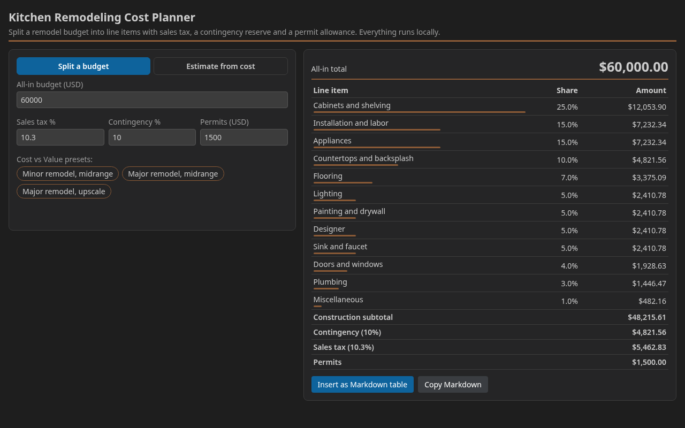

# Kitchen Remodeling Cost Planner for VS Code

Plan a kitchen remodel budget without leaving your editor. Split an all-in budget into 12 line items
(cabinets, labor, appliances, countertops, flooring, lighting and more) with sales tax, a contingency
reserve and a permit allowance, or start from a construction cost and see what the job really costs.
Then drop the breakdown into your notes, bid comparison or project README as a Markdown table.

The maths is the same integer-cent kitchen remodeling cost library published on npm as
[`kitchen-remodeling-cost`](https://www.npmjs.com/package/kitchen-remodeling-cost), so every line adds up
to the cent.



## Features

- **Cost planner panel**: `Kitchen Remodeling: Open Cost Planner` opens a side-by-side planner with
  two modes, *Split a budget* (the number you can spend, tax and permits included) and *Estimate from
  cost* (adds contingency, sales tax and permits on top of a contractor's construction price).
- **Cost vs Value presets**: one click loads a minor midrange, major midrange or major upscale kitchen
  remodel (Pacific region averages, 200 sq ft kitchen).
- **Insert as Markdown**: `Kitchen Remodeling: Insert Cost Breakdown (Markdown Table)` asks for an amount
  and a permit allowance and writes a ready-to-commit table at the cursor. The panel has the same
  *Insert* and *Copy Markdown* buttons.
- **Exact totals**: integer-cent arithmetic with largest-remainder rounding, so the line items always
  sum to the construction subtotal and the split total always equals your budget.
- **Private by design**: no telemetry, no network requests, no accounts. The webview runs under a
  strict Content Security Policy and only loads files bundled with the extension.

## Usage

1. Open the Command Palette (`Ctrl+Shift+P` / `Cmd+Shift+P`).
2. Run **Kitchen Remodeling: Open Cost Planner**, type a budget (for example `60000`) and adjust sales
   tax, contingency and permits.
3. Click **Insert as Markdown table** to paste the breakdown into the last active editor, or run
   **Kitchen Remodeling: Insert Cost Breakdown** directly from any Markdown file (also on the editor
   right-click menu).

Example output for a $60,000 all-in budget with a $1,500 permit allowance:

| Line item | Share | Amount |
|---|---:|---:|
| Cabinets and shelving | 25.0% | $12,053.90 |
| Installation and labor | 15.0% | $7,232.34 |
| Appliances | 15.0% | $7,232.34 |
| Countertops and backsplash | 10.0% | $4,821.56 |
| … | | |
| **Construction subtotal** |  | **$48,215.61** |
| Contingency reserve (10%) |  | $4,821.56 |
| Sales tax (10.3%) |  | $5,462.83 |
| Permit allowance |  | $1,500.00 |
| **Total** |  | **$60,000.00** |

## Settings

| Setting | Default | Meaning |
|---|---|---|
| `kitchenRemodelingCostPlanner.taxRate` | `10.3` | Sales tax percent on construction plus contingency |
| `kitchenRemodelingCostPlanner.contingencyRate` | `10` | Contingency reserve percent |
| `kitchenRemodelingCostPlanner.defaultPermit` | `1500` | Permit allowance offered by the insert command |

Figures are planning estimates, not a contractor bid. Line-item shares follow the HomeGuide kitchen
remodel cost breakdown; presets follow Cost vs Value 2025 Pacific region averages.

## Development

```bash
npm run compile      # syntax-check every script
npm test             # unit tests for the cost maths and Markdown output
npm run screenshot   # re-render images/screenshot.png with headless Chrome
npm run package      # build the .vsix with @vscode/vsce
```

`npm run sync-core` copies the shared library from `packages/npm/lib/index.js`.

## Links

Built by the team behind [Kitchen Remodeling Bellevue](https://wakitchenremodelingbellevue.com/), a
design-build kitchen remodeling contractor in Bellevue, WA that lists sales tax and permit fees as
their own lines on every bid.

- Source: <https://github.com/nbkdevs/kitchen-remodeling-bellevue/tree/main/packages/vscode>
- Privacy: the extension collects nothing. Site privacy policy: <https://wakitchenremodelingbellevue.com/privacy/>

## License

MIT
